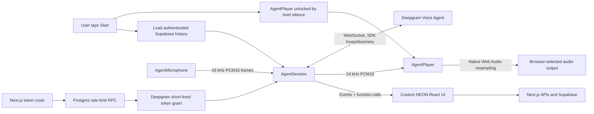

# NEON voice path — Deepgram-maintained browser architecture

NEON uses the **official pinned** `@deepgram/agents@0.2.0` SDK for its complete browser-side voice transport, microphone capture, and audio output pipeline. Custom `AudioEngine`, `NativePcmPlayer`, audio worklet source, and hand-rolled WebSocket/reconnect implementations have been **removed**.

This change replaces the previous two attempts at custom playback buffering because they could not reliably reproduce the laptop's real hardware behavior.

## Components

The Deepgram SDK owns `AgentSession` for socket lifecycle, `AgentMicrophone` for capture and `AgentPlayer` for decoded PCM playback. NEON manages only presentation, note confirmation, visual scenes and persisted conversation context.

### Capture

- 16,000 Hz signed 16-bit PCM, single channel; this matches the `AgentMicrophone` target sample rate and `AgentSession.audio.input.sampleRate`.
- Browser microphone constraints enable acoustic echo cancellation, noise suppression and automatic gain.
- The SDK uses its audio worklet and handles device sample rate behavior.
- Microphone capture starts after `settings-applied` and stops to release the device when muted, disconnected or ended.
- **No custom browser microphone device selection** is provided: the official SDK does not expose a `deviceId` option. Choose the microphone using browser/operating-system input selection.

### Playback

- 24,000 Hz signed 16-bit PCM (Deepgram output). The SDK's `AgentPlayer` owns decoding, scheduling, audio analyser and interruption.
- A 10 ms silent frame creates the player's Web Audio output during the initial user gesture to avoid desktop audio autoplay restrictions.
- `session.on("audio", player.queue)` forwards PCM directly with **no custom jitter buffer**, ring buffer, resampler or PCM transform.
- On `user-started-speaking`, `player.interrupt()` stops queued audio. On `agent-audio-done`, NEON checks `getRemainingPlaybackTime()` before changing its visible speaking/listening indicator.
- The player owns audio device resampling. The reported 24 kHz rate in Sound diagnostics is the **stream rate**, not the laptop's physical speaker rate.

### Transport and tools

- The SDK issues new short-lived tokens through `/api/deepgram/token` via `tokenFactory`; the Deepgram API key remains only on the Next.js server.
- AgentSession owns reconnect backoff, settings handshake, short-lived-token refresh, buffered audio during the handshake, and KeepAlive messages.
- Saved conversation context is loaded when starting/resuming/retrying. The SDK restores conversation text and completed function-call context across its automatic reconnects.
- Client-side tools remain explicitly allowlisted and `save_note` still requires human consent.

## Laptop troubleshooting

1. **Confirm the correct branch is deployed.** Verify the Vercel commit SHA contains the official SDK refactor. Deploying `master` or an earlier preview will still use the old audio engine.
2. **Compare keyboard mode to microphone mode.** Keyboard mode does not open the mic, but still plays Deepgram voice. If keyboard mode sounds clear, suspect microphone echo or headset routing rather than response audio decoding.
3. **Windows Bluetooth headsets:** opening a Bluetooth headset microphone may switch its speakers into the low-bandwidth hands-free profile. Select your laptop's built-in microphone under Windows Settings → System → Sound → Input; keep the headset as output. On some systems you must explicitly select the stereo playback device.
4. **Monitor Sound diagnostics.** Audio gaps estimate late arrivals when the SDK has almost no queued audio; they do not prove server/network failure. Speech-interruption counts increasing when you are silent suggest echo-induced barge-in. Run the same test on laptop speakers and wired headphones.
5. **Check Windows enhancements and drivers.** Disable output enhancements/spatial processing as a controlled A/B test. Test another browser. Updating or reinstalling the audio driver's correct vendor version can resolve system-level glitches.
6. **Send actual evidence if still broken:** Vercel deployment SHA, browser/OS, wired/Bluetooth/inbuilt speakers, whether keyboard mode also stutters, and Sound diagnostics gap/interruption numbers.

Deepgram docs:
- https://developers.deepgram.com/docs/browser-agent-javascript
- https://developers.deepgram.com/docs/browser-agent-react
- https://developers.deepgram.com/docs/voice-agent-message-flow
- https://developers.deepgram.com/docs/voice-agent-audio-playback

Microsoft Bluetooth:
- https://learn.microsoft.com/en-us/windows-hardware/drivers/bluetooth/bluetooth-classic-audio

## Verification status

The repository's CI validates imports, TypeScript, lint, the official SDK integration contract, security scan and production build. This is **not a substitute for device testing**. The user must test the deployed branch in the failing Windows environment; the SDK may still be affected by Bluetooth hands-free routing, browser permissions, OS driver issues or unstable connectivity.
